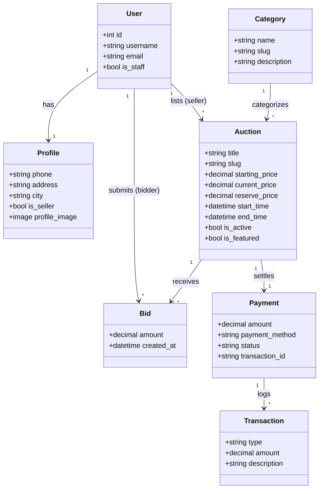

# 🏛️ AuctionHub — Online Auction Platform

[](https://www.python.org/)
[](https://www.djangoproject.com/)
[](https://www.postgresql.org/)
[](https://getbootstrap.com/)
[](LICENSE)

**AuctionHub** is a modern, full-featured web-based online auction marketplace built with **Django** and **PostgreSQL**. It empowers users to list items for auction, place competitive bids, track auction progress in real-time, process secure payments upon winning, and monitor performance through an analytics dashboard.

---

## 📌 Table of Contents

- [Features](#-features)
- [System Architecture & Tech Stack](#-system-architecture--tech-stack)
- [Database Schema & Models](#-database-schema--models)
- [Getting Started & Installation](#-getting-started--installation)
- [Seed Data & Demo Accounts](#-seed-data--demo-accounts)
- [Application URLs & Navigation](#-application-urls--navigation)
- [Project Directory Structure](#-project-directory-structure)
- [License](#-license)

---

## ✨ Features

### 👤 User Roles & Authentication
- **Multi-Role Access Control**: Anonymous visitors, registered bidders, verified sellers, and staff administrators.
- **Account Management**: User registration, login, logout, profile customization (avatar, contact info, address), and seller mode toggle.

### 📦 Auction Listings & Management
- **Listing Creation & Editing**: Sellers can create auctions with starting price, reserve price, countdown start/end times, category, and high-resolution images.
- **Search, Filter & Sort**: Filter auctions by category, status (Active/Ended), price range, or keyword search with sorting options (ending soonest, price low/high, newest).
- **Featured Items**: Curated showcase on the homepage for highlighted listings.

### 🔨 Real-Time Bidding Engine
- **Automated Validation**: Bids must exceed the current highest bid and meet minimum increment rules.
- **Bid History**: Transparent bidding logs showing bidder history and timestamped bids.
- **Self-Bid Protection**: Prevents sellers from bidding on their own listings.
- **Winner Determination**: Automatic winner identification upon auction closing.

### 💳 Checkout & Payment Processing
- **Secure Checkout Flow**: Allows winning bidders to fulfill payments for won items.
- **Payment Methods Supported**: Credit/Debit Card, PayPal, Bank Transfer, and Digital Wallet simulations.
- **Transaction History**: Downloadable invoices, receipts, and order statuses (`PENDING`, `COMPLETED`, `FAILED`).

### 📊 Staff Dashboard & Analytics
- **Executive Analytics**: Key performance indicators including total revenue, active auction volume, total bids, and conversion rates.
- **Detailed Reports**: Dedicated views for Auction Reports, Seller Performance, Bidder Reports, and User Analytics.
- **Custom Admin Interface**: Enhanced Django Admin (`BidVerseAdminSite`) tailored with branded UI styles.

### 🎨 Modern UI & Interactive Experience
- **Theme Toggle**: Dark/Light mode and dynamic vibe themes.
- **Responsive Layout**: Designed mobile-first using Bootstrap 5.3 and FontAwesome 6 icons.
- **Interactive Portfolio Page**: Custom interactive About Me showcase with animated tech stack and project feature cards.

---

## 🏗️ System Architecture & Tech Stack

- **Backend Framework:** [Django 6.0](https://www.djangoproject.com/) (Python 3.14+)
- **Database:** [PostgreSQL](https://www.postgresql.org/) (via `psycopg2-binary`)
- **Frontend / Templating:** Django Template Engine (DTL), [Bootstrap 5.3](https://getbootstrap.com/), [Font Awesome 6.4](https://fontawesome.com/)
- **Media & Image Processing:** [Pillow](https://python-pillow.org/)
- **Architecture Pattern:** Model-View-Template (MVT) modular design split into 5 core apps:
  - `accounts`: User authentication, profile management, and database seed commands.
  - `auctions`: Categories, auction listings, bidding logic, and search.
  - `payments`: Checkout, invoices, payment lifecycle, and transactions.
  - `reports`: Aggregated analytical reports for staff and sellers.
  - `dashboard`: Staff management hub and portfolio showcase.

---

## 🗄️ Database Schema & Models



---

## 🚀 Getting Started & Installation

### Prerequisites
- **Python 3.14+** (or Python 3.11+)
- **PostgreSQL 14+**
- **Git**

### 1. Clone the Repository
```bash
git clone https://github.com/KagenouTanish/Online-Auction.git
cd Online-Auction/online_auction
```

### 2. Create and Activate Virtual Environment
```bash
# Windows (PowerShell)
python -m venv venv
.\venv\Scripts\Activate.ps1

# macOS / Linux
python3 -m venv venv
source venv/bin/activate
```

### 3. Install Dependencies
```bash
pip install -r requirements.txt
```

### 4. Configure Database
Ensure PostgreSQL is running locally, then create the database:
```sql
CREATE DATABASE online_auctiondb;
```
*(If your PostgreSQL credentials differ from the defaults in `auction_project/settings.py`, update the `DATABASES` configuration accordingly).*

### 5. Apply Migrations
```bash
python manage.py migrate
```

### 6. (Recommended) Seed Demo Data
Populate the database with pre-configured categories, auctions, bids, and users:
```bash
python manage.py seed_data
```
*(Type `yes` when prompted).*

### 7. Run the Development Server
```bash
python manage.py runserver
```
Visit the application in your browser at: **[http://127.0.0.1:8000/](http://127.0.0.1:8000/)**

---

## 👥 Seed Data & Demo Accounts

When seeded via `python manage.py seed_data`, the following test accounts are ready to use:

| Username | Password | Role | Permissions |
| :--- | :--- | :--- | :--- |
| `admin` | `admin123` | **Superuser / Staff** | Full Access (`/admin/`, `/dashboard/`, all reports) |
| `john_seller` | `john123` | **Seller** | Can create, edit, manage auctions |
| `jane_seller` | `jane123` | **Seller** | Can create, edit, manage auctions |
| `mike_buyer` | `mike123` | **Bidder / Buyer** | Bids on auctions, completes payments |
| `sarah_buyer` | `sarah123` | **Bidder / Buyer** | Bids on auctions, completes payments |
| `alex_buyer` | `alex123` | **Bidder / Buyer** | Bids on auctions, completes payments |

---

## 🗺️ Application URLs & Navigation

| URL Path | View Description | Access Level |
| :--- | :--- | :--- |
| `/` | Homepage (Featured auctions, hero banner, categories) | Public |
| `/auctions/` | Auction catalog with search, filters, and sorting | Public |
| `/auctions/<slug>/` | Auction detail page with live bid log & bidding form | Public / Auth to bid |
| `/auctions/create/` | Create a new auction listing | Sellers only |
| `/accounts/register/` | User registration | Public |
| `/accounts/login/` | User authentication | Public |
| `/accounts/profile/` | Edit user profile and switch to seller role | Authenticated |
| `/payments/process/<id>/` | Payment checkout page for won auctions | Winning Bidder |
| `/payments/history/` | User payment history and receipts | Authenticated |
| `/dashboard/` | Administrative metrics and operational overview | Staff only |
| `/dashboard/about-me/` | Interactive developer portfolio & tech showcase | Public |
| `/reports/auctions/` | Detailed auction status reports | Staff only |
| `/admin/` | Custom-styled Django Administration panel | Staff only |

---

## 📂 Project Directory Structure

```text
online_auction/
├── manage.py                          # Django CLI entry point
├── requirements.txt                   # Project package dependencies
├── .gitignore                         # Git exclusion rules
├── auction_project/                   # Root configuration package
│   ├── settings.py                    # Django configuration settings
│   ├── urls.py                        # Top-level URL routing
│   ├── admin.py                       # BidVerseAdminSite customization
│   ├── middleware.py                  # Custom admin styling middleware
│   └── wsgi.py / asgi.py
├── accounts/                          # Authentication & profile app
│   ├── models.py                      # Profile model
│   ├── views.py / forms.py            # Auth views & forms
│   └── management/commands/seed_data.py # Demo database seeder
├── auctions/                          # Core auction and bidding app
│   ├── models.py                      # Category, Auction, Bid models
│   ├── views.py / forms.py            # Catalog, bidding, CRUD views
│   └── urls.py
├── payments/                          # Checkout and transaction app
│   ├── models.py                      # Payment & Transaction models
│   ├── views.py / urls.py
├── reports/                           # Analytics and export app
│   ├── views.py / urls.py
├── dashboard/                         # Staff dashboard & portfolio app
│   ├── views.py / urls.py
│   └── static/                        # Dashboard static assets
├── templates/                         # HTML templates
│   ├── base.html                      # Global layout (navbar, theme toggle, footer)
│   ├── accounts/                      # Auth & profile templates
│   ├── auctions/                      # Catalog & bidding templates
│   ├── dashboard/                     # Admin & about me templates
│   ├── payments/                      # Checkout & receipt templates
│   └── reports/                       # Report templates
└── media/                             # Uploaded auction images & avatars
```

---

## 📄 License

This project is licensed under the MIT License — see the [LICENSE](LICENSE) file for details.
